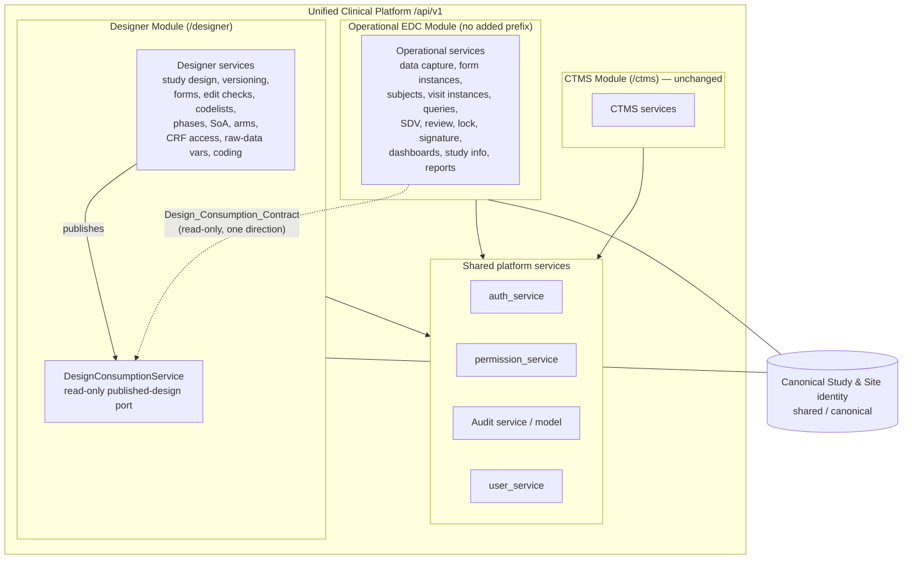
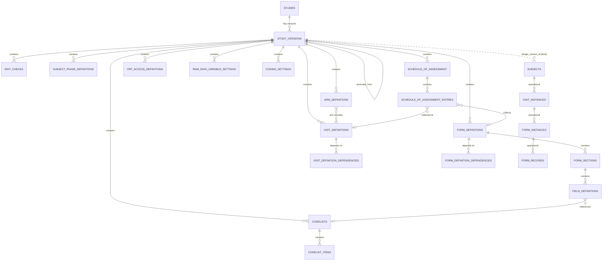
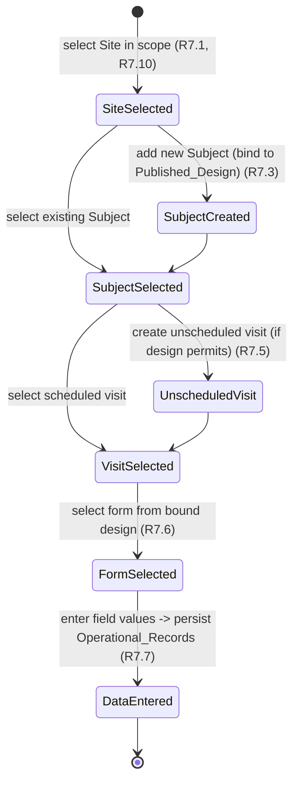

# Design Document: Designer / EDC Refactor

## Overview

This design describes a **reorganization** of the existing combined EDC capability of the Unified_Clinical_Platform into two cohesive first-party modules — a **Designer_Module** (design-time) and a leaner operational **EDC_Module** — connected by a one-directional, read-only publication contract. It is explicitly **not** a greenfield build: every component described here already exists today inside a single EDC domain, and the refactor redistributes ownership of that existing code and data across two modules without altering stored values (R11).

### What exists today

The backend is organized by domain subpackage across parallel layers:

```
app/
  models/{edc,ctms,pv,shared}
  services/{edc,ctms,pv,shared}
  repositories/{edc,ctms,pv,shared}
  schemas/{edc,ctms,pv,shared}
  api/routes/{edc,ctms,pv,shared}
```

`app/main.py` mounts one aggregated `APIRouter` per domain under `/api/v1`: `shared_router`, `ctms_router`, `pv_router`, an optional `pv_ai_router`, and `edc_router`. The EDC and shared aggregates add **no prefix of their own**, so each resource router keeps the exact path it declares (`/studies`, `/sites`, `/visits`, …); the CTMS and PV aggregates carry their `/ctms` and `/pv` prefixes. Domain separation is deliberate: disabling CTMS or PV never changes EDC behavior.

Two facts in the current EDC domain make this refactor low-risk:

1. **A draft/published version lifecycle already exists.** `StudyVersion` carries `version_number`, a `status` of `draft`/`published`, `amendment_reason`, a self-referential `amended_from_version_id` pointing at the published source, `published_at`, and `published_by`. This is the natural, already-built basis for the `Design_Version` / `Published_Design` / `Draft_Design` concepts in the requirements (R2).
2. **A metadata-vs-clinical split already exists at the row level.** `VisitDefinition` is already distinct from `VisitInstance`; `FormDefinition`, `FormSection`, `FieldDefinition`, `Codelist`, and `CodelistItem` are design-time metadata, while subjects, visit instances, form instances, form records, and field values are clinical. The refactor **formalizes module ownership on top of this existing separation** rather than inventing it.

### Package strategy (decision)

We introduce a **new `designer` domain subpackage** in each layer that owns design-time concerns, and we slim the existing `edc` subpackage down to operational concerns:

```
app/
  models/designer/        services/designer/        repositories/designer/
  schemas/designer/       api/routes/designer/
```

A new `designer_router` aggregate is mounted in `app/main.py` alongside the existing aggregates, following the exact same mounting pattern. **Decision — the Designer aggregate carries a `/designer` prefix** (like CTMS/PV), while the slimmed EDC aggregate continues to add no prefix of its own so operational resource paths (`/studies` operational reads, `/sites`, `/subjects`, `/visits`, …) are unchanged for existing clients. Rationale: Designer is a new surface with no backward-compatibility obligation, so a clear namespace prefix is preferable; the operational EDC surface must preserve existing paths to satisfy R11 backward compatibility.

Rationale for a sibling domain (rather than a sub-package of `edc`): the whole point of the refactor is independent ownership (R1). A sibling `designer` domain mirrors how CTMS and PV already achieve isolation, keeps the dependency arrow explicit (EDC depends on a Designer read port, never the reverse), and lets access-control scope cleanly to a module (R10).

Mounting order in `main.py` becomes: `shared_router`, `ctms_router`, `pv_router`, optional `pv_ai_router`, **`designer_router`**, `edc_router`.

**Requirements covered:** R1, R2, R11, and the module-separation framing underlying all requirements.

## Architecture

The platform keeps its domain-isolated shape. Designer and the operational EDC are co-equal siblings over a shared platform layer (auth, permission, audit, user, notification, export, file attachment). CTMS is unchanged. The only coupling between Designer and EDC is a **one-directional Design_Consumption_Contract**: Designer publishes immutable `Published_Design` content; EDC reads it read-only and binds operational records to a `Design_Version`.



Key architectural rules:

- **One-directional flow (R2.6, R1.1–R1.4).** EDC services depend on the Designer read port. Designer services have **no** dependency on EDC services. There is no code path from Designer into operational tables, and no code path from EDC that writes Designer tables.
- **Shared canonical identity (R1.5, R1.6).** `Study` and `Site` identity is canonical and shared. Neither module mints a competing identity; both reference the same rows.
- **Shared audit (R1.7, R10.7, R11.7).** The existing shared append-only audit service records events for both modules, tagged with the owning module.
- **CTMS untouched (R-Introduction).** No CTMS model, service, route, or mount changes.

**Requirements covered:** R1, R2, R10, R11.

## Components and Interfaces

### Ownership mapping (MOVE / STAY / SHARED)

This table is the heart of the refactor. "MOVE" means the existing artifact's ownership moves into the new `designer` subpackage; "STAY" means it remains in the slimmed `edc` subpackage; "SHARED" means it lives in the shared platform layer and is referenced by both.

| Existing artifact (today in `edc`)                                                                     | Disposition                                   | Target                                                                     | Requirement          |
| ------------------------------------------------------------------------------------------------------ | --------------------------------------------- | -------------------------------------------------------------------------- | -------------------- |
| `study` model — design-time metadata/versioning aspects                                                | MOVE (design-time) / SHARED (identity)        | `designer` owns version metadata; `Study` **identity** is SHARED canonical | R1.1, R1.5, R11.1    |
| `study_version_service`, `study_version_repository`                                                    | MOVE                                          | `designer` (Design_Version lifecycle)                                      | R2, R11.1            |
| `studies` routes — design-time parts (version create/publish/amend)                                    | MOVE                                          | `designer`                                                                 | R2                   |
| `studies` routes — operational read/study-info parts                                                   | STAY                                          | `edc`                                                                      | R8                   |
| `form_metadata` model (`FormDefinition`, `FormSection`, `FieldDefinition`, `Codelist`, `CodelistItem`) | MOVE                                          | `designer`                                                                 | R4, R6, R11.1        |
| `form_metadata_service`, `form_templates`                                                              | MOVE                                          | `designer`                                                                 | R4                   |
| `forms` / `fields` routes (definition authoring)                                                       | MOVE                                          | `designer`                                                                 | R4                   |
| Codelists (currently inside `form_metadata`)                                                           | MOVE                                          | `designer` (codelist design)                                               | R6                   |
| `edit_check` model, `edit_check_service`, `edit_check_examples`, `edit_check_repository`               | MOVE                                          | `designer` (rule design)                                                   | R5, R11.1            |
| `edit_checks` routes (authoring/testing rules)                                                         | MOVE                                          | `designer`                                                                 | R5                   |
| `VisitDefinition` (design-time)                                                                        | MOVE                                          | `designer`                                                                 | R4.2–R4.4, R11.1     |
| `visit_service` — definition-authoring parts                                                           | MOVE                                          | `designer`                                                                 | R4                   |
| `VisitInstance` (operational occurrences)                                                              | STAY                                          | `edc`                                                                      | R7, R11.2            |
| `visit_service` — instance parts; `visits` routes (instances)                                          | STAY                                          | `edc`                                                                      | R7                   |
| `data_capture_service`                                                                                 | STAY                                          | `edc`                                                                      | R7                   |
| `form_instance_service`, `form_record` model, `repeating_record_service`                               | STAY                                          | `edc`                                                                      | R7, R11.2            |
| `subject` model (instances) + `subject_service`                                                        | STAY                                          | `edc`                                                                      | R7, R11.2            |
| `query`, `sdv`, `review`, `lock`, `signature` models + services                                        | STAY                                          | `edc`                                                                      | R7, R8, R11.2, R11.4 |
| `site` model — operational aspects + `site_service`                                                    | STAY (operational) / SHARED (identity)        | `edc`; `Site` **identity** is SHARED canonical                             | R1.5, R7, R8         |
| `dashboards` routes, `dashboard_service`                                                               | STAY                                          | `edc` (metrics/study-info)                                                 | R8.4                 |
| `study_service` — operational study-info reads                                                         | STAY                                          | `edc`                                                                      | R8                   |
| `exports` routes, `export_service`                                                                     | STAY (operational) / SHARED (platform export) | `edc` reporting uses shared export                                         | R9                   |
| **NEW:** subject phase definitions                                                                     | NEW                                           | `designer`                                                                 | R3                   |
| **NEW:** schedule of assessment                                                                        | NEW                                           | `designer`                                                                 | R4.1                 |
| cycle definitions → folded into `visit_definitions` (`visit_type='cycle'`), migration 0052             | FOLDED                                        | `designer`                                                                 | R4.4                 |
| **NEW:** arm definitions                                                                               | NEW                                           | `designer`                                                                 | R4.5                 |
| **NEW:** CRF access definitions                                                                        | NEW                                           | `designer`                                                                 | R4.6                 |
| **NEW:** raw-data variable settings                                                                    | NEW                                           | `designer`                                                                 | R4.7                 |
| **NEW:** coding settings                                                                               | NEW                                           | `designer`                                                                 | R4.8                 |
| `auth_service`, `permission_service`, `user_service`, audit, notification, file attachment             | SHARED (unchanged)                            | `shared`                                                                   | R1.7, R10            |

### Designer_Module services

- **`study_version_service`** (moved) — owns the `Design_Version` lifecycle: create draft, validate, publish, amend. Reuses the existing `StudyVersion` draft/published mechanics.
- **`form_metadata_service`**, **`form_templates`** (moved) — form/section/field definitions and templates.
- **`edit_check_service`**, **`edit_check_examples`** (moved) — declarative rule authoring and design-time rule testing (R5.3: evaluate a test case without creating any Operational_Record).
- **New services:** `subject_phase_service`, `schedule_of_assessment_service`, `arm_service`, `crf_access_service`, `raw_data_variable_service`, `coding_setting_service`, `codelist_service` (codelist design split out from form metadata), `form_dependency_service`, `visit_dependency_service`. Cycle authoring is part of the visit authoring service (`visit_definition_service`), since a cycle is a visit of `visit_type='cycle'`.
- **`DesignConsumptionService`** — the read port described below.

### EDC_Module services (slimmed)

`data_capture_service`, `form_instance_service`, `repeating_record_service`, `subject_service`, operational `visit_service`, `query_service`, `sdv_service`, `review_service`, `lock_service`, `signature_service`, operational `site_service`, `dashboard_service`, and operational parts of `study_service`. Each reads design-dependent configuration **only** through `DesignConsumptionService`.

### The Design_Consumption_Contract

A single read-only port in `app/services/designer`, consumed by EDC services. It exposes **only Published_Design content** (R2.5) and returns read-only views (R2.6). EDC never writes Designer tables (R1.3) — this is enforced both by the service boundary (EDC imports the read port, never Designer write services or repositories) and by role/permission (R10).

```python
# app/services/designer/design_consumption_service.py  (interface sketch)
class DesignConsumptionService:
    def get_published_design(self, design_version_id: UUID) -> PublishedDesignView: ...
    def get_latest_published_design(self, study_id: UUID) -> PublishedDesignView | None: ...
    def list_forms(self, design_version_id: UUID) -> list[FormDefinitionView]: ...
    def get_form_fields(self, design_version_id: UUID, form_id: UUID) -> list[FieldDefinitionView]: ...
    def list_visit_definitions(self, design_version_id: UUID) -> list[VisitDefinitionView]: ...  # now includes cycles (visit_type == 'cycle')
    def list_arm_definitions(self, design_version_id: UUID) -> list[ArmDefinitionView]: ...
    def list_form_dependencies(self, design_version_id: UUID) -> list[FormDependencyView]: ...
    def list_visit_dependencies(self, design_version_id: UUID) -> list[VisitDependencyView]: ...
    def list_edit_check_rules(self, design_version_id: UUID) -> list[EditCheckRuleView]: ...
    def list_codelists(self, design_version_id: UUID) -> list[CodelistView]: ...
    def list_subject_phase_definitions(self, design_version_id: UUID) -> list[SubjectPhaseDefinitionView]: ...
    def get_schedule_of_assessment(self, design_version_id: UUID) -> ScheduleOfAssessmentView: ...
    def list_crf_access_definitions(self, design_version_id: UUID) -> list[CrfAccessDefinitionView]: ...
    def list_raw_data_variable_settings(self, design_version_id: UUID) -> list[RawDataVariableSettingView]: ...
    def list_coding_settings(self, design_version_id: UUID) -> list[CodingSettingView]: ...
    def permits_unscheduled_visits(self, design_version_id: UUID) -> bool: ...  # R7.5
```

Contract guarantees:

- **Published-only (R2.5).** Any `design_version_id` whose status is `draft` yields a not-found/validation error from the port; the port never returns draft content.
- **Read-only views (R2.6).** Returns immutable view objects (frozen dataclasses / read schemas), not ORM entities EDC could mutate.
- **No reverse dependency.** The port lives in `designer`; EDC imports it. Designer imports nothing from EDC.

### Router aggregates

- **`designer_router`** — new aggregate in `app/api/routes/designer/__init__.py` collecting design-authoring resource routers (study versions, forms/fields, form dependencies, edit checks, codelists, subject phases, SoA, arms, visits, visit dependencies, CRF access, raw-data variables, coding). The arm router also exposes a list route. Mounted with a `/designer` prefix.
- **`edc_router`** — unchanged mounting style (no added prefix); its resource list is slimmed to operational routers (subjects, visit instances, form_data, records, queries, sdv, reviews, locks, signatures, dashboards, exports, operational study-info reads). Design-authoring routers are removed from this aggregate.

**Requirements covered:** R1, R2, R3, R4, R5, R6, R7, R8, R9, R10, R11.

## Data Models

The refactor **reassigns ownership** of existing tables and adds a small set of new design-time tables plus additive `design_version_id` binding columns where operational tables do not yet carry one. **No table or column renames are required**; disposition is a code-layer ownership change plus additive migrations (R11.1, R11.2 — stored values unchanged).

### Designer-owned tables

- **`study_versions`** — reused directly as **`Design_Version`**. `status in {draft, published}` already maps to `Draft_Design` / `Published_Design`; `amended_from_version_id` already models amendment lineage (R2.9–R2.11); `published_at` / `published_by` capture publication actor/timestamp (R2.2).
- **`form_definitions`, `form_sections`, `field_definitions`** — reassigned to Designer (R4), each FK to `study_versions`.
- **`codelists`, `codelist_items`** — reassigned to Designer (R6), FK to `study_versions`.
- **`edit_checks`** — reassigned to Designer (R5), FK to `study_versions`, stored declaratively (R5.5).
- **`visit_definitions`** — reassigned to Designer (R4.2–R4.4), FK to `study_versions`. Now carries a `visit_type` discriminator (`visit` | `cycle`, plus the legacy `scheduled`/`unscheduled`/`screening` values) and nullable cycle metadata (`repeat_min`, `repeat_max`, `cycle_length`); the former `cycle_definitions` / `cycle_definition_visits` tables are folded in and dropped (migration 0052). (`visit_instances` stays in EDC.)
- **NEW `subject_phase_definitions`** — `(design_version_id FK, name, display_order, …)`, unique name within a design version (R3).
- **NEW `arm_definitions`** — study arms/treatment groups, FK to `study_versions` (R4.5); arm↔visit membership via **NEW `arm_definition_visits`** (R: arm defines which visits occur in the arm).
- **NEW `schedule_of_assessment`** — mapping of forms/procedures to visit definitions (cycles included, single `visit_definition_id`), FK to `study_versions` (R4.1).
- **NEW `crf_access_definitions`** — design-time read/write access of each operational role to each form/field, FK to `study_versions` (R4.6), with a form/question-level `blinded` flag and optional `unblind_role`.
- **NEW `raw_data_variable_settings`** — raw-data variable name/type/attributes per captured item, FK to `study_versions` (R4.7), plus explicit `label` and `suffix` dataset-generation columns.
- **NEW `coding_settings`** — dictionary reference + coding rule per coded item, FK to `study_versions` (R4.8).
- **NEW `form_definition_dependencies`** — typed self-referential form→form dependencies (self-guarded).
- **NEW `visit_definition_dependencies`** — typed self-referential visit→visit dependencies (cycles included, self-guarded).

All Designer child tables bind to a `Design_Version` (`study_versions.id`) so that publishing freezes the whole bundle immutably (R2.4).

### EDC-owned operational tables (stay put, bind to a design version)

`subjects`, `visit_instances`, `form_instances`, `form_records`, field values, `queries`, `sdv`, `reviews`, `locks`, `signatures`. Each binds to the `Design_Version` it runs against via **`design_version_id`** (R2.7, R7.3). Where a binding column does not already exist, it is added by an **additive** migration (nullable → backfilled → enforced), never a rename (R11.2). Subjects bind at study-conduct start (R2.7); Version Upgrade rebinds affected records to a newer `design_version_id` (R8.3).

### Designer ER (key tables + the EDC binding)



A `CYCLE` is a `VISIT_DEFINITION` with `visit_type = 'cycle'`; SoA, arms, and dependencies reference visits uniformly. (`SCHEDULE_OF_ASSESSMENT_ENTRIES`, `ARM_DEFINITION_VISITS`, and the two dependency tables are the net-new nodes/edges of the domain-model refactor.)

The dotted edge from `STUDY_VERSIONS` to `SUBJECTS` is the **binding**, not ownership: EDC owns `subjects` and the operational tree below it, and each binds to the published `Design_Version` it runs against. This formalizes the existing metadata-vs-clinical separation into explicit module ownership.

Conventions preserved everywhere: UUID primary keys, soft-delete via `deleted_at`, timezone-aware timestamps, SQLAlchemy 2.0 `Mapped`/`mapped_column`.

**Requirements covered:** R2, R3, R4, R5, R6, R7, R8, R11.

## Data Entry Flow

The operational `Data_Entry_Flow` is a **sequential state machine** in the EDC_Module. Each step reads the bound `Published_Design` through the `DesignConsumptionService`; the user cannot advance until the prior step is complete (R7.8).



Behavioral rules:

- **Scope-gated site selection (R7.1, R7.10).** Only sites within the user's authorization scope are selectable (via `permission_service.filter_sites`); selecting an out-of-scope site is rejected with a not-authorized error.
- **Binding at subject start (R7.3, R2.7).** Adding a new subject binds it to exactly one `Published_Design`. If no `Published_Design` exists for the site, subject creation is rejected and study data is left unchanged (R7.9, R2.8).
- **Unscheduled visits (R7.5).** Allowed only where the bound design permits them, checked via `DesignConsumptionService.permits_unscheduled_visits`.
- **Design-driven form/fields (R7.6, R7.7).** Form choices and field sets come from the bound design; entered values persist as Operational_Records.
- **Step ordering (R7.8).** Attempting to skip ahead is rejected, the current step is retained, and the error identifies the incomplete prior step.

**Requirements covered:** R7, R2.7, R2.8.

## Study Info Area and Report Area

Both are organized as **EDC sub-areas** — grouped operational services and resource routers inside the slimmed `edc` subpackage. All **design-dependent** configuration reads through the `DesignConsumptionService`; none of it authors Designer_Definitions (R8.14, R1.4).

### Study_Info_Area (R8)

Sub-areas mapped to services/routers (reading the bound design where design-dependent):

- Study Information (Study Information, Status Configuration, ID Configuration) — R8.1
- CRF Version management (Version Upgrade, Version History, Edit Check Testing Case, Access Control) — R8.2
- Metrics (Study Summary, Subject Summary) — R8.4
- Alerts (AE, eDiary, CRF, Subject Phase, Query, Visit Window, Edit Check, Non-Compliance, Payment) — R8.5
- Subject (Subject Phase, Subject Information, Source Document) — R8.6
- SDV / SDR (settings, workload, result) — R8.7, R8.8
- Lab (Lab Define, Site Normal Range, External Lab Data, Summary, Conversion Factor and Range Report, Operational History) — R8.9
- External Data Source (Data Import, Data Sync) — R8.10
- Adjudication (where enabled) — R8.11
- SAEs (Form Define, Related Form, Report Setting, Alert, Report, Audit) — R8.12
- Conversion, Data Validation, System Integration, eDiary, eCOA, Workflow, Site Payment, Translation, IRT Integration — R8.13

**Version Upgrade (R8.3, R8.15).** Rebinds affected Operational_Records from their current `design_version_id` to a newer `Design_Version`, recording the upgrade in the shared audit service. The rebind is transactional: if it fails before all affected records are rebound, affected records stay bound to their prior `Design_Version`, the failed attempt is audited, and an error is returned (R8.15). The whole area reads design-dependent config through the consumption contract (R8.14).

### Report_Area (R9)

A reporting surface of grouped read-only services/routers: Data Summary (R9.1), CRF Status (R9.2), Query Report (R9.3), Enrollment Status (R9.4), eCOA/eDiary Report (R9.5), On-Demand / KRI / SDV-SDR Workload / Data Analysis / Comment / Source Document Tracker (R9.6), End of Study (R9.7). Every report is **scope-filtered server-side** (`permission_service`): results include only in-scope records (R9.8), return an empty set when nothing is in scope (R9.9), and reject unauthorized report access with a not-authorized error (R9.10). Reports use the shared export service for output.

**Requirements covered:** R8, R9.

## Access Control and Separation of Duties

Enforcement reuses the existing shared `permission_service` (`require`, `resolve_scope`, `filter_studies`, `filter_sites`, `assert_object_access`). The refactor adds module-scoped permission codes and roles — **`Designer_Role`** (design-time permissions in the Designer_Module) and **`Operational_Role`** (operational permissions in the EDC_Module) — and enforces them **server-side, independently of any frontend check, default-deny** (R10.4).

- **Role→module scoping (R10.1).** Designer permissions are grantable only to Designer_Roles; operational permissions only to Operational_Roles.
- **Ownership denials (R1.3, R1.4, R10.2, R10.3).** A non-Designer attempting to author a Designer_Definition is denied with a Designer_Role-not-met result and no change; a non-Operational user attempting to author an Operational_Record is denied symmetrically. The ownership checks are layered under the service boundary (EDC has no write path into Designer tables and vice versa) so a mis-routed call fails both structurally and by permission.
- **Default-deny (R10.4).** When server-side authorization cannot be confirmed, the request is denied.
- **Single-role users (R10.5).** A user with exactly one of the two roles gets access only to that module and is denied all permissions scoped to the other.
- **Both-role users (R10.6).** A user holding both roles has each permission set enforced **only within its own module scope**; one role's permissions never authorize an action in the other module.
- **Denial auditing (R10.7).** Every denial of a create/modify on a Designer_Definition or Operational_Record records one immutable audit event (actor, attempted module scope, attempted action, denial).

**Requirements covered:** R10, R1.3, R1.4, R1.7.

## Migration Strategy

The `Migration_Process` is **phased, reversible, and value-preserving** (R11). It performs ownership reassignment at the code/module layer plus **additive** schema changes; it avoids table/column renames to minimize risk.

**Phase 0 — Snapshot & guards.** Record pre-migration counts and value checksums per record set (studies, study versions, visit definitions, form definitions, form sections, field definitions, codelists, codelist items, edit checks; and subjects, visit instances, form instances, form records, field values). These feed the post-migration verification (R11.5).

**Phase 1 — Create the Designer package (code).** Add `app/{models,services,repositories,schemas,api/routes}/designer`, move the design-time models/services/routes into it, and mount `designer_router`. This reassigns **ownership** of existing design-time rows to the Designer_Module **without altering stored values** (R11.1). Existing `study_versions` rows with `status = published` become consumable `Published_Design`s immediately (R11.3).

**Phase 2 — Slim the EDC package (code).** Remove design-authoring routers/services from the `edc` aggregate, keeping operational flows. All operational data-entry, query, SDV, review, and lock flows continue to work against their bound `Published_Design` (R11.4).

**Phase 3 — Additive binding columns (schema).** Where an operational table lacks `design_version_id`, add it as nullable, backfill from the subject's bound version (or the study's current published version), then enforce not-null. Additive only — no renames (R11.2).

**Phase 4 — Reassignment audit (data).** Record reassignments as immutable audit events (R11.7), and preserve all existing audit history with no physical removal (R11.8).

**Phase 5 — Verify.** Confirm for every reassigned record set that post-migration count equals pre-migration count **and** each reassigned record's stored values equal its pre-migration values (R11.5).

**Abort semantics (R11.6).** If any record cannot be reassigned without data loss, the process aborts, leaves pre-migration records unchanged, and reports which record set failed. Each phase is reversible: code phases roll back by reverting ownership mounting; the additive schema phase rolls back by dropping the added nullable columns before enforcement.

**Requirements covered:** R11.

## Correctness Properties

_A property is a characteristic or behavior that should hold true across all valid executions of a system — essentially, a formal statement about what the system should do. Properties serve as the bridge between human-readable specifications and machine-verifiable correctness guarantees._

These properties were derived from the acceptance-criteria prework and consolidated to remove redundancy. Presence/surface-area criteria (R8.1–R8.2, R8.4–R8.13, R9.1–R9.7) and read-path/flow criteria (R8.14, R11.4) are verified by smoke/integration tests instead of properties (see Testing Strategy). Boundary and error criteria (R1.6, R2.3, R2.8, R2.10, R4.3, R4.9, R5.2, R6.3, R7.9, R7.10, R9.9, R9.10, R11.6) are exercised as edge cases within the generators of the properties below.

### Property 1: Module-ownership invariant

_For all_ Designer_Definitions and all Operational_Records, and for every write attempt routed through the opposing module, the EDC_Module never creates or mutates a Designer_Definition and the Designer_Module never creates or mutates an Operational_Record; the attempt is rejected, the target value is unchanged, and the error identifies the owning module.

**Validates: Requirements 1.1, 1.2, 1.3, 1.4**

### Property 2: One-directional, published-only consumption

_For all_ reads performed by the EDC_Module through the Design_Consumption_Contract, the result contains only Published_Design content (never Draft_Design content) and is a read-only view that exposes no path to mutate Designer state.

**Validates: Requirements 2.5, 2.6**

### Property 3: Published-design immutability

_For all_ Published_Designs and all mutation attempts targeting a published Design_Version or any of its child Designer_Definitions, the modification is rejected and the targeted value is unchanged.

**Validates: Requirements 2.4**

### Property 4: Single published-design binding at subject start

_For all_ subjects for whom study conduct is started, the subject is bound to exactly one Published_Design (identified by its Design_Version) and to the selected Site.

**Validates: Requirements 2.7, 7.3**

### Property 5: Amendment creates one draft and retains history

_For all_ Published_Designs and all amendments with a reason of 1 to 4,000 characters inclusive, exactly one new Draft_Design is created and every prior Published_Design version remains retrievable.

**Validates: Requirements 2.9, 2.11**

### Property 6: Data-entry step-ordering invariant

_For all_ Data_Entry_Flow states and all attempts to advance to a later step before the required prior step is complete, the advance is rejected, the current step is retained, and the error identifies the incomplete prior step; selectable sites, forms, and fields at each step are always a subset of the user's scope and the bound Published_Design.

**Validates: Requirements 7.1, 7.2, 7.4, 7.6, 7.7, 7.8**

### Property 7: Name uniqueness within a draft design

_For all_ draft Design_Versions and all named Designer_Definitions requiring uniqueness (subject phase definitions, codelists), two definitions with the same name cannot both persist; the second is rejected, the first is unchanged, and the error identifies the duplicate name.

**Validates: Requirements 3.1, 3.2, 6.1, 6.2**

### Property 8: Designer child binds to exactly one design version

_For all_ Designer child definitions (subject phase definitions, edit-check rules, codelists, visit definitions (including `visit_type='cycle'`), arms, CRF access, raw-data variable settings, coding settings), each is associated with exactly one Design_Version.

**Validates: Requirements 3.3, 5.4, 6.4**

### Property 9: Designer definition persistence round-trip

_For all_ valid Designer_Definitions (schedule of assessment mappings, visit definitions (cycles as `visit_type='cycle'`), visit/form dependency edges, CRF access matrices, raw-data variable settings, coding settings), persisting then reading the definition back through the Designer_Module yields values equal to those submitted.

**Validates: Requirements 4.1, 4.2, 4.4, 4.6, 4.7, 4.8**

### Property 10: Rule testing produces no operational side effects

_For all_ Edit_Check_Rules and all provided test cases, evaluating the rule returns a pass/fail verdict, creates zero Operational_Records, and performs no execution of user-provided code (declarative evaluation only).

**Validates: Requirements 5.3, 5.5**

### Property 11: Version upgrade rebind is atomic and complete

_For all_ sets of Operational_Records bound to a Design_Version, a Version Upgrade either rebinds every affected record to the newer Design_Version (recording the upgrade in the Audit_Service) or, on failure, leaves every affected record bound to its prior Design_Version (recording the failed attempt); no partial rebind is ever observable.

**Validates: Requirements 8.3, 8.15**

### Property 12: Report scope-filtering invariant

_For all_ Report_Area requests and all users, every record in the result is within the requesting user's authorization scope, and when no records fall within scope the result is empty rather than containing out-of-scope records.

**Validates: Requirements 9.8, 9.9**

### Property 13: Module-scoped separation of duties with default-deny

_For all_ requests to create or modify a Designer_Definition or an Operational_Record, authorization is evaluated server-side and a role authorizes an action only within its own module scope: a user lacking the required module role is denied with the target unchanged, a user holding only one role is denied all permissions scoped to the other module, a user holding both roles never has one role authorize an action in the other module, and any request whose server-side authorization cannot be confirmed is denied.

**Validates: Requirements 10.2, 10.3, 10.4, 10.5, 10.6**

### Property 14: Exactly one immutable audit event per auditable action

_For all_ changes to a Designer_Definition or Operational_Record, all authorization denials, and all migration reassignments, the Audit_Service records exactly one immutable (append-only) audit event identifying the owning/attempted module scope, the actor, the entity, the action/change, and the timestamp.

**Validates: Requirements 1.7, 10.7, 11.7**

### Property 15: Migration preserves record count and values

_For all_ reassigned record sets, the post-migration record count equals the pre-migration count and each reassigned record's stored values equal its pre-migration values.

**Validates: Requirements 11.1, 11.2, 11.5**

### Property 16: Published designs remain consumable after migration

_For all_ study versions published before migration, the version remains consumable by the EDC_Module through the Design_Consumption_Contract after migration.

**Validates: Requirements 11.3**

### Property 17: Audit history is preserved across migration

_For all_ audit events present before migration, the same events are present after migration (the post-migration audit set is a superset of the pre-migration set, with no physical removal).

**Validates: Requirements 11.8**

## Error Handling

Error handling reuses the platform's existing exception handlers (registered in `app/main.py`) and returns structured, non-leaking error indications. By category:

- **Ownership violations (R1.3, R1.4).** A write routed into the wrong module returns an ownership error naming the owning module; the target is never mutated. These are caught at the service boundary (the opposing module has no write repository for the target) and reinforced by permission checks.
- **Identity conflicts (R1.6).** Attempts to mint a competing Study/Site identity are rejected with a conflict error identifying the conflicting identity.
- **Publication/validation failures (R2.3, R4.9, R5.2, R6.3).** A draft that fails design validation stays a draft; the error identifies the specific failing definition, schema violation, or missing codelist reference. No partial publish occurs.
- **Immutability violations (R2.4).** Any mutation of a published design or its children returns an immutability error, unchanged state.
- **Amendment bounds (R2.10).** Empty or >4,000-character amendment reasons are rejected with no draft created.
- **Validation bounds (R3.2, R4.3, R6.2).** Duplicate names and invalid visit windows (lower > upper) are rejected with field-identifying errors; nothing is persisted.
- **No-published-design (R2.8, R7.9).** Starting conduct or adding a subject with no Published_Design is rejected; study data is left unchanged.
- **Data-entry ordering (R7.8).** Out-of-order advancement is rejected with the incomplete prior step named; current step retained.
- **Authorization denials (R7.10, R9.10, R10.2–R10.6).** Out-of-scope sites, unauthorized reports, and cross-module/unconfirmed authorizations are denied server-side by default; each denial is audited (R10.7).
- **Version Upgrade failure (R8.15).** Partial rebind is impossible: on failure the transaction rolls back, affected records remain on the prior Design_Version, the failed attempt is audited, and an error is returned.
- **Migration abort (R11.6).** Any data-loss risk aborts the migration, leaves pre-migration records unchanged, and reports the record set that could not be reassigned.

All errors are logged through the existing structured-logging/request-ID middleware without leaking safety content, request bodies, or secret values.

## Testing Strategy

A dual approach: **property-based tests** verify the universal invariants above across many generated inputs; **example-based unit tests**, **edge-case tests**, **integration tests**, and **smoke tests** cover concrete scenarios, boundaries, cross-flow behavior, and surface area.

### Property-based tests

- **Library.** Use **Hypothesis** (already present in the backend; a `.hypothesis` cache exists). Do not hand-roll property testing.
- **Iterations.** Each property test runs a **minimum of 100 iterations**.
- **One test per property.** Implement each of Properties 1–17 with a single property-based test.
- **Tagging.** Tag each test with a comment referencing its design property, format:
  `# Feature: designer-edc-refactor, Property {number}: {property_text}`
- **Generators.** Build Hypothesis strategies for: Designer_Definitions (phases, visit defs with valid/invalid windows (including `visit_type='cycle'` with repeat/cycle_length metadata), arms, codelists with 1–1000 items, edit-check rules including code-injection-shaped payloads, CRF access matrices, raw-data variable settings, coding settings), Design_Versions in draft/published states, operational flow states, users with Designer/Operational/both/neither roles and varying site scopes, and pre/post migration datasets. Edge and error criteria (R1.6, R2.3, R2.8, R2.10, R4.3, R4.9, R5.2, R6.3, R7.9, R7.10, R9.9, R9.10, R11.6) are embedded as generated inputs within the relevant property's strategy.

### Example-based unit tests

Cover criteria classified as examples: publishing a valid draft transitions to published and records actor/timestamp (R2.1, R2.2), persisting an arm definition (R4.5), and representative publication-validation success/failure cases. Keep these focused — the properties already cover broad input coverage.

### Edge-case tests

Explicit boundary tests for amendment-reason bounds (0, 1, 4000, 4001 chars), visit-window ordering at equality and inversion, codelist item counts at 1 and 1000, duplicate-name collisions, and competing-identity attempts.

### Integration tests

- **Consumption read-path (R8.14).** Verify design-dependent study-info reads route through `DesignConsumptionService` and never touch Designer write paths.
- **Operational continuity post-migration (R11.4).** Run representative data-entry, query, SDV, review, and lock flows end-to-end against a bound Published_Design after a simulated migration; assert they succeed.
- **Router mounting.** Verify `designer_router` mounts under `/designer` and the slimmed `edc_router` preserves existing operational paths with no added prefix, and that CTMS/PV mounting is unchanged.

### Smoke tests

Verify each Study_Info_Area sub-area (R8.1–R8.2, R8.4–R8.13) and Report_Area report (R9.1–R9.7) endpoint is mounted and responds, confirming surface-area completeness without input variation.

### Verification alignment with migration

Migration verification (Property 15, R11.5) runs as part of the `Migration_Process` itself (count + value-equality checks) and is additionally exercised as a property test over generated datasets so the preservation guarantee holds across input shapes, not just the production dataset.
